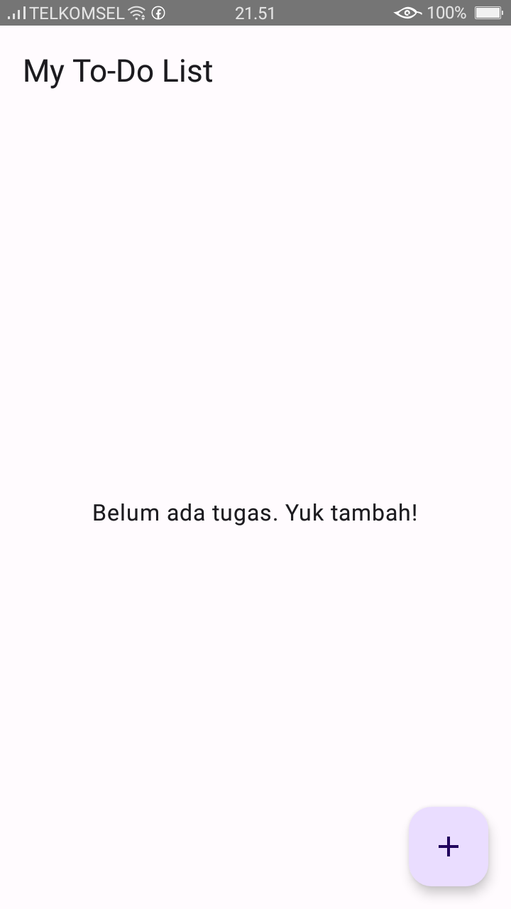
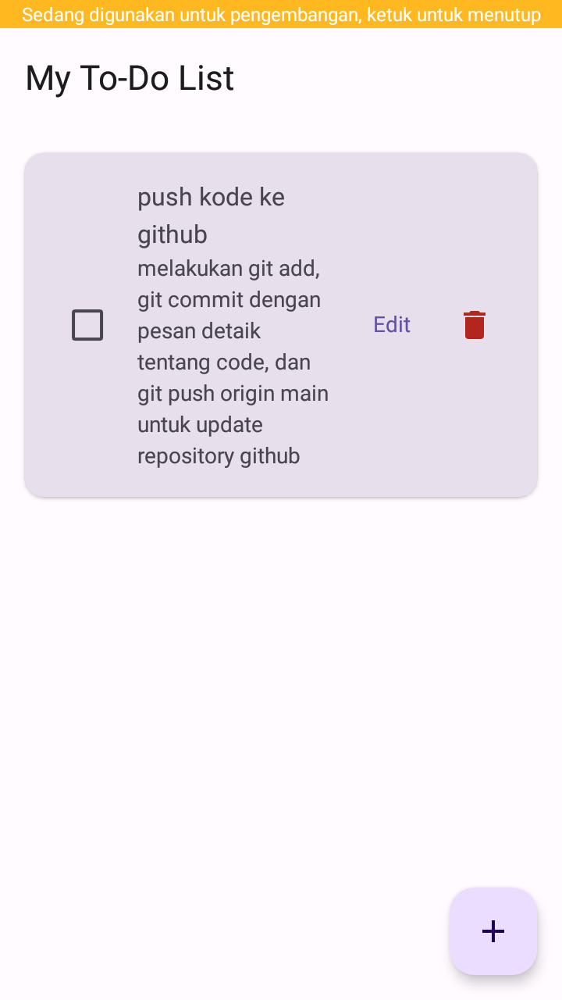
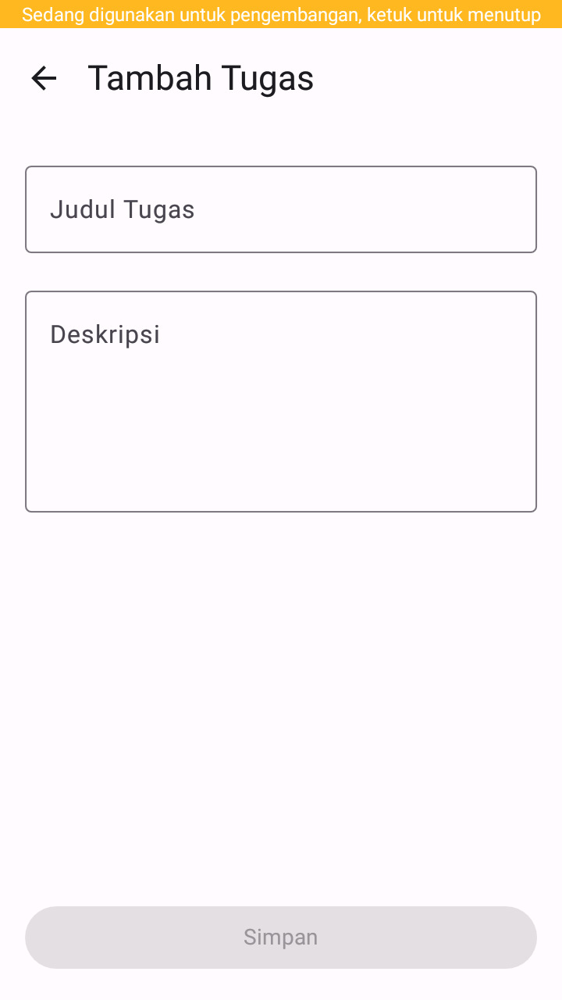

# 📝 Compose To-Do List

A modern, clean, and efficient To-Do List application built with **Jetpack Compose** dan **MVVM Architecture**. This project demonstrates best practices in Android development, including local database management, reactive UI, and clean code structure.

## 📱 App Preview

| Home Screen | Task List | Add Task |
| :---: | :---: | :---: |
|  |  |  |

Captured from a physical Oppo A57 via ADB.

## ✨ Features
- ✅ **Add, Edit, and Delete** tasks seamlessly.
- ✅ **Mark as Completed** with a smooth checkbox interaction.
- ✅ **Persistent Storage**: Tasks are saved locally using Room Database.
- ✅ **Real-time UI Updates**: The list updates instantly using Kotlin Flow.
- ✅ **Clean Architecture**: Follows the MVVM pattern for maintainability.

## 🛠️ Tech Stack
- **UI**: Jetpack Compose, Material 3 Design
- **Architecture**: MVVM (Model-View-ViewModel)
- **Local Database**: Room Database + Kotlin Flow
- **Concurrency**: Kotlin Coroutines
- **Navigation**: Jetpack Navigation Compose

## 🚀 How to Run
1. Clone this repository: `git clone https://github.com/legisetiawan/Compose-TodoList.git`
2. Open the project in **Android Studio**.
3. Sync the project with Gradle files.
4. Run the app on an Android Emulator or a physical device (Min SDK 23).

---
*Built with ❤️ by [Legi Setiawan](https://github.com/legisetiawan)*# Compose-TodoList
# 📝 Compose To-Do List

A modern, clean, and efficient To-Do List application built with **Jetpack Compose** and **MVVM Architecture**. This project demonstrates best practices in Android development, including local database management, reactive UI, and clean code structure.

## 📱 App Preview

| Task List | Add/Edit Task |
| :---: | :---: |
|  |  |

## ✨ Features
- ✅ **Add, Edit, and Delete** tasks seamlessly.
- ✅ **Mark as Completed** with a smooth checkbox interaction.gi
- ✅ **Persistent Storage**: Tasks are saved locally using Room Database.
- ✅ **Real-time UI Updates**: The list updates instantly using Kotlin Flow.
- ✅ **Clean Architecture**: Follows the MVVM pattern for maintainability.

## 🛠️ Tech Stack
- **UI**: Jetpack Compose, Material 3 Design
- **Architecture**: MVVM (Model-View-ViewModel)
- **Local Database**: Room Database + Kotlin Flow
- **Concurrency**: Kotlin Coroutines
- **Navigation**: Jetpack Navigation Compose

## 🚀 How to Run
1. Clone this repository: `git clone https://github.com/legisetiawan/Compose-TodoList.git`
2. Open the project in **Android Studio**.
3. Sync the project with Gradle files.
4. Run the app on an Android Emulator or a physical device (Min SDK 23).

---
*Built with ❤️ by [Legi Setiawan](https://github.com/legisetiawan)*
